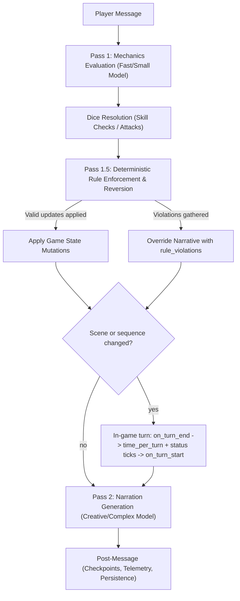

# TaleWeaver Architecture Concept

This document details the core architectural concepts of TaleWeaver for AI agents and human developers.

---

## 1. Adventure Manifest (`WorldManifesto`, `.adv`, `.adz`)

TaleWeaver adventures are represented as self-contained blueprints following specification version `1.3`:
* **`.adv`**: UTF-8 JSON file containing the complete world manifest (`WorldManifesto`).
* **`.adz`**: ZIP archive containing `adventure.adv` plus localized media in `assets/` (scene backgrounds, entity portraits, audio).

### Key Manifest Components
* **`adventure`**: World metadata, title, teaser, lore context, plot overview, tone, time pacing (`time_per_turn`, default: 5 min), rule mode (`"rpg"`, `"story"`, `"chat"`), and win/loss conditions (`completed_condition`, `gameover_condition`).
* **`protagonist`**: Avatar baseline: name, class role, HP/max HP, stamina/mana, RPG stats (`strength`, `dexterity`, `intelligence`, `wisdom`, `charisma`, `armor_class`), starting inventory, and equipped items.
* **`scenes`**: Graph nodes representing spatial locations (`id`, `label`, `description`, `image_url`).
* **`exits`**: Graph edges between scenes (`from_scene_id`, `to_scene_id`, `exit_type`, `is_locked`, `code_to_unlock`, `item_to_unlock`, `rule_to_unlock`).
* **`npcs`**: Non-player characters with spatial position, stats, inventory, hidden flag, movement type (`STATIONARY` vs `MOVABLE`), and optional TTS voice.
* **`objects`**: Interactive scene items or inventory objects (`CONTAINER`, `SWITCH`, `WEAPON`, `WEARABLE`, `CONSUMABLE`, `KEY`, `READABLE`, `CONSTRUCTABLE`). Containers support locks and nested items; switches hold finite state machines (`switch_states`, `switch_actions`).
* **`quests`**: Main and side quests with clear objectives and EXP rewards.
* **`awards`**: Achievements (`bronze`, `silver`, `gold`) evaluated during turn execution.
* **`scripts`**: Sandboxed Python event scripts reacting to triggers (`on_turn_start`, `on_enter_scene`, `on_interact`, `on_turn_end`) via the `tw` GameContext API. `on_turn_start`/`on_turn_end` fire on in-game turn boundaries (scene or sequence change), not on every message.

---

## 2. In-Game Turn Loop & Multi-Pass Pipeline (`GameTurnManager`)

Every player message executes through a deterministic, guardrailed multi-pass architecture in [gameplay_logic.py](file:///d:/DEV/repositories/git/taleweaver/backend/api/routes/adventures/gameplay_logic.py), with shared building blocks in `turn_pass_flow.py` (guardrail chain, turn clock) and `turn_prompt_layout.py` (message layout):

### In-Game Turns (Turn Clock)
* An **in-game turn** spans all player messages within one scene and active sequence. It is NOT the same as a player message.
* Only when the scene or the active sequence changes (`turn_pass_flow.crossed_turn_boundary`), the engine runs `on_turn_end` (old turn), advances `time_per_turn` and status-effect ticks, then runs `on_turn_start` (new turn).
* LLM-requested `extra_time_minutes` still applies on any message. Per-message script logic belongs in `on_logic_pass_done` / `on_narration_done`.

### Prompt Layout (Token Efficiency)
* System prompts are **static** (persona, adventure frame, rules, formatting, voice direction) so providers can cache them across messages; Anthropic models get explicit `cache_control` breakpoints (`backend/core/llm_request_tuning.py`).
* Everything volatile (CURRENT STATE block: time, location, NPCs, character sheet, notes, memories, compressed history; quests/awards; outcome; violations; reminders) goes into the **latest user message**.
* Pass 2 history contains only player/GM messages of previous turns; system events are kept for the current message only, and `[DEBUG` lines are never sent.

### Pass 1: Mechanics Evaluation (Small/Fast Model)
* Uses `small_model` (e.g. Gemini Flash / GPT-4o-mini) with the trimmed structured output schema `MechanicsIntent` (strict/story) or `ChatProgressionIntent` (chat mode) from `backend/engine/interaction/llm_intents.py`, converted to `GameEvent` afterwards. Backend-filled result fields and generator tools are never sent to the model.
* Evaluates player intent against current scene state plus the tail of the last GM narration (to resolve references like "open it").
* Generates requested state updates:
  * Skill checks (`requested_skill_checks`) & attacks (`requested_attacks`).
  * Entity updates (opening containers, moving items, flipping switches).
  * Exit lock state changes & proposed scene transitions (`new_scene_id`).
* Its `narrative_description` is a short English draft; translation happens in Pass 2 only.
* **Rule**: Spontaneous/dynamic item generation is strictly disabled. Items must already exist in world/NPC definitions.

### Mechanics Resolution: Deterministic Dice Engine
* Attack rolls: Evaluated against target Armor Class (`roll_attack`).
* Skill checks: Evaluated against DC using character stats (`roll_skill_check`).
* Results are surfaced transparently to the user as system event messages.

### Pass 1.5: Rule Validation & Reversion (Critical Guardrail)
* **Design Rule**: Never parse freeform text to identify which entity or container the player is interacting with.
* Instead, systematically inspect any state updates requested by the LLM in Pass 1:
  * **Sequence Soft Rules** (`guardrails/soft_rules.py`, `engine/rules/soft_rules.py`): sequences may declare `soft_rules` (`id`, natural-language `condition`, `script`, `text`, `guard_expression`, `max_triggers`). Pass 1 only sees `{id, condition}` of the active sequence's open rules and reports fulfilled ones in `triggered_soft_rule_ids`; Pass 1.5 runs first in the chain, checks sequence scope, trigger limit (`entity_states["__soft_rule_counts__"]`) and guard, then executes the script. Rejected rules are dropped silently (not violations).
  * **Choice Dialogs** (`engine/scripting/dialog.py`, `dialog_service.py`, `dialog_routes.py`): scripts call `tw.dialog.choose(prompt, options, on_choice=...)`; the call only records `changeset.pending_dialog`, which every changeset applier stores in `entity_states["__pending_dialog__"]` (first dialog wins). `GET /chat` exposes it as `pending_dialog` (handler name stripped), `POST /chat` returns 409 while it is open, and `POST /{game_id}/dialog/choice` clears it, saves a `[Choice] <label>` user message, runs the init-script handler with the option index, applies its changeset and optionally narrates (`narrate=True`, small model).
  * **Interaction Triggers** (`engine/interaction/interaction_targets.py`, `interaction_hooks.py`): an entity counts as interacted with when Pass 1 reports it in `updated_entities` or the player's message names a reachable entity (current scene or inventory; all context-menu commands do). For each, top-level and active-sequence `on_interact` scripts run, then the entity's inline `on_interact_script` / `on_interact_text` (`metadata_json`, objects and NPCs).
  * **Sequence Scripts** (`engine/rules/sequence_scripts.py`): `sequence.scripts` (same shape as top-level scripts, no `on_init`) are appended to the top-level scripts in `GameTurnManager._get_script_runner()` only while that sequence is active.
  * **Containers & Exits (Deterministic Unlock Guard)**: Validate if `item_to_unlock` is in inventory, `unlock_code` matches, or if deterministic guard `unlock_expression` evaluates to truthy. Execute `on_unlock_success` or `on_unlock_failure` scripts accordingly.
  * **Exits & Movement**: Validate exit locks, destination scene graph connectivity, and fire transition hooks (`on_leave_scene`, `on_open_exit`, `on_exit_used`, `on_enter_scene`) while preventing accidental teleports from hypothetical chat.
  * **Switches**: Verify state transitions match allowed `switch_states`.
  * **Constructables**: A `CONSTRUCTABLE` is a recipe (meta item, never visible). Validate that all `combination_ingredients` are reachable and verify `craft_guard_expression`; then consume the ingredients (except `kept_ingredients`) and reveal the hidden `result_item_ids`. Hidden craft-only results (no `reveal_rule`, not another item's `reveals_item_id`) may not be spawned or revealed by the GM.
  * **Quests & Awards (Deterministic Hard Rules & Scripting Guards)**: Validate LLM-proposed quest completions and award grants against defined hard rules (`required_item_id`, `required_scene_id`, `required_defeated_npc_id`, `guard_expression`). If any configured hard rule is unmet, the completion/grant is reverted and recorded as a rule violation, forcing Pass 2 to narrate the unmet condition.
  * **Hidden Entities**: Require explicit search/inspection actions before revealing hidden NPCs or items.
* **Reversion Mechanism**: Any invalid state change is immediately **reverted** back to its pre-turn database state.
* Violations are recorded into the `rule_violations` list.

### Pass 2: Narration Generation (Complex/Creative Model)
* Uses `complex_model` (e.g. Gemini Pro / Claude Opus / GPT-4o) with streaming narration.
* Receives a TURN RESOLUTION block in the latest user message:
  1. Technical outcome JSON (pruned `GameEvent` summary).
  2. Draft narration from Pass 1.
  3. **Critical Violation Overrides**: If `rule_violations` contains entries, `game_event.narrative_description` is replaced with the failure reason.
  4. Vocal/TTS style tags (`[excited]`, `<sigh>`, `<whisper>`) for atmospheric speech.
* The narration view of the location never contains lock secrets (codes, key items, unlock rules); unlocks are resolved by Pass 1 and the guardrails.
* **Enforcement**: This forces the creative model to narrate failure accurately rather than hallucinating success.

### Post-Message: Persistence & Checkpoints
* Updates committed to SQLite `SessionState`.
* Checkpoints created on milestones (`SCENE_CHANGE`, `QUEST_UPDATE`, `AWARD_GRANTED`).
* Performance metrics logged via `log_structured_event` (p50/p90 latency monitoring); narration token usage (incl. cached prompt tokens) as `gm.turn.pipeline.tokens`.

---

## 3. Session State & Entity Overrides

* **Template Immutability**: `AdventureTemplate`, `WorldScene`, and `WorldEntity` templates remain unchanged during play.
* **Session State (`SessionState`)**:
  * `entity_states`: JSON dictionary recording dynamic per-entity mutations (e.g., current HP, lock states, spatial position, visibility).
  * `avatar.inventory`: Live item list carried by the player.
  * `current_scene_id`: Active player location.
* **Exit Resolution Rule**:
  * Always resolve session-scoped exits by preferring session records over template records to respect dynamic in-game unlocking.

---

## 4. Engine Package Layout (`backend/engine/`)

Domain logic lives in subpackages; new modules go into the matching one instead of the package root:

| Package | Contents |
| --- | --- |
| `adventures/` | Adventure packages: importer, exporter, cloner, updates/version checks, generator service, entity bundles, license defaults. |
| `sessions/` | Session start scene, checkpoints, session import/export, memory manager. |
| `world/` | World generation: generator, world/scripting prompts, manifest schemas, manifest applier entry point. |
| `manifest_apply/` | Applying generated manifests to the database (scenes, objects, NPCs, ...). |
| `blueprint/` | World-Builder blueprint parser, key tables and validation. |
| `rules/` | Game rules and mechanics: rule engine, hard/soft rules, skill checks, stats, dice, items, crafting recipes, quests, sequences. |
| `interaction/` | Player interaction: command parser, interaction targets, LLM intents, location context, map, switches, triggers. |
| `combat/` | Turn-based combat rules: initiative, special/area attacks, weapons. |
| `scripting/` | Sandboxed scripting engine and the `tw` API. |
| `media/` | Image generation, image prompts, BFL payloads. |
| `audio/` | TTS engine and helpers, voice casting, ElevenLabs. |
| `debug_commands/` | `/debug` commands and the debug engine. |

---

## 5. Diagnostics & Inspection Tools

Always use the built-in diagnostic CLI tool rather than crafting ad-hoc SQL queries:
* **List adventures**: `python scripts/inspect_state.py list-adventures`
* **Inspect adventure & manifest**: `python scripts/inspect_state.py show-adventure "<title_or_id>" --manifest`
* **Inspect active session state**: `python scripts/inspect_state.py show-session <session_id> --inventory --entities`
* Specialized Agent Skills:
  * `taleweaver-inspector`: Deep session state and entity diagnostics.
  * `taleweaver-dev-tools`: Security keys, admin resets, thumbnail generation.
  * `taleweaver-telemetry`: LLM latency and pipeline benchmark analysis.
