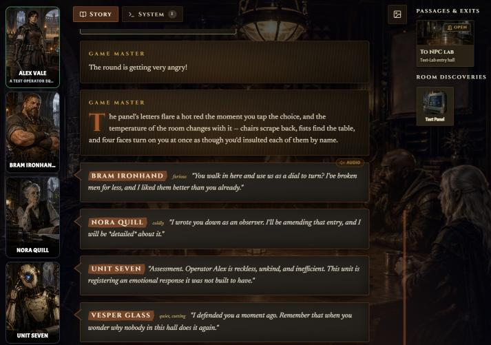
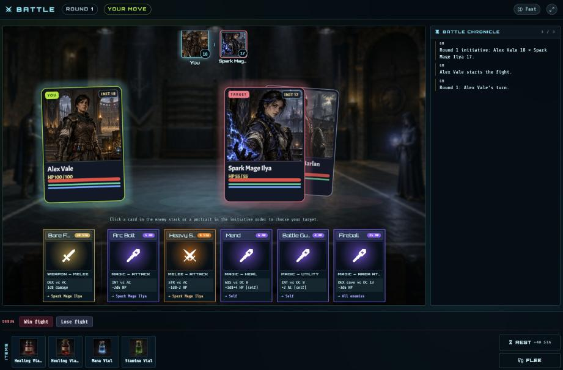
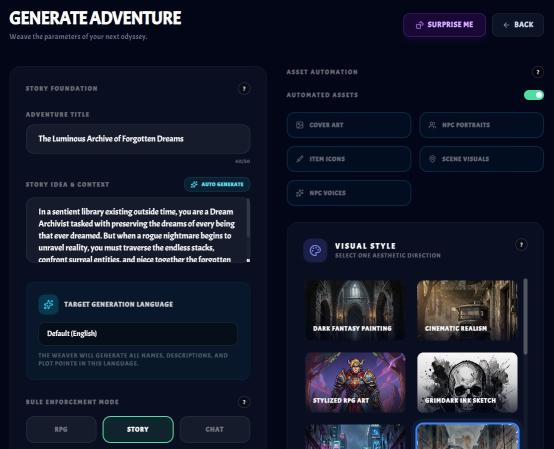
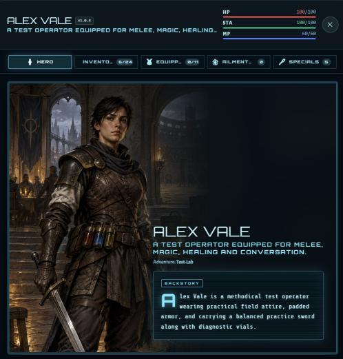
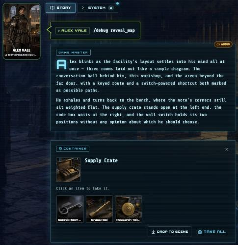
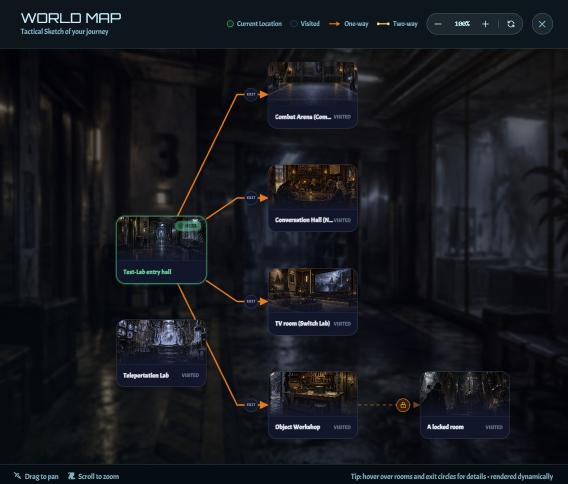
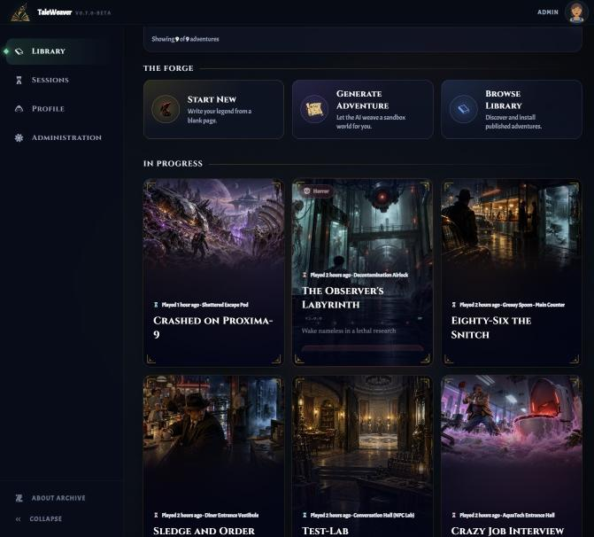
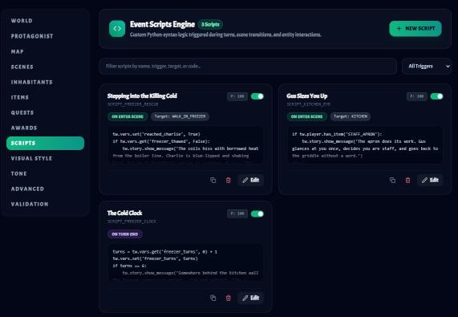
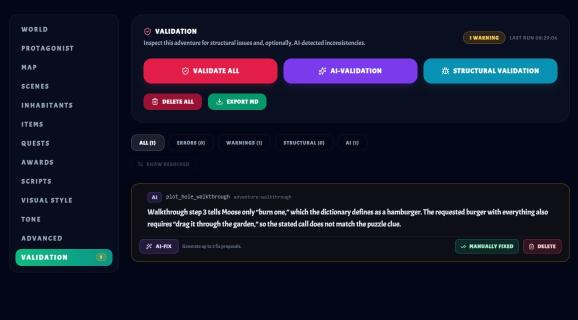

<div align="center">


# TaleWeaver

**Weave Living Stories. Craft and Play Immersive AI Adventures.**

An open-source, local-first interactive fiction engine combining adaptive AI storytelling with deterministic Python game mechanics, cinematic voices, and agent authoring tools.

[](LICENSE)


[Features](#-key-features) · [Quick Start](#-quick-start) · [Agent Skills](#-create-with-ai-agents) · [AI Ecosystem](#-supported-ai-ecosystem) · [Docker](#-running-with-docker) · [Scripting](#-sandboxed-python-scripting)

</div>

<br />

<table>
  <tr>
    <td width="33%"><a href="docs/screenshots/gameplay.jpg"></a></td>
    <td width="33%"><a href="docs/screenshots/combat-dialog.jpg"></a></td>
    <td width="33%"><a href="docs/screenshots/generator.jpg"></a></td>
  </tr>
  <tr>
    <td align="center"><sub><b>Comic Story Feed</b>: dynamic AI narration with speaker portraits & comic speech bubbles</sub></td>
    <td align="center"><sub><b>Tactical Combat</b>: card-based combat with turn initiative and enemy target deck</sub></td>
    <td align="center"><sub><b>World Generator</b>: synthesize complete adventures, lore, and Python scripts from a prompt</sub></td>
  </tr>
  <tr>
    <td width="33%"><a href="docs/screenshots/character-sheet.jpg"></a></td>
    <td width="33%"><a href="docs/screenshots/loot-dialog.jpg"></a></td>
    <td width="33%"><a href="docs/screenshots/editor-map.jpg"></a></td>
  </tr>
  <tr>
    <td align="center"><sub><b>Character Sheet & Gear</b>: real-time gauges, equipment slots, and 24-slot backpack</sub></td>
    <td align="center"><sub><b>Containers & Spoils</b>: search chests and adversaries with item inspection and rarity tiers</sub></td>
    <td align="center"><sub><b>Directed Cartography</b>: interactive topological maps with real-time pathfinding</sub></td>
  </tr>
  <tr>
    <td width="33%"><a href="docs/screenshots/library-catalog.jpg"></a></td>
    <td width="33%"><a href="docs/screenshots/editor-script-engine.jpg"></a></td>
    <td width="33%"><a href="docs/screenshots/editor-validation.jpg"></a></td>
  </tr>
  <tr>
    <td align="center"><sub><b>Adventure Catalog</b>: browse and download curated community campaigns and modules</sub></td>
    <td align="center"><sub><b>Python Event Scripting</b>: deterministic game logic running in a sandboxed AST interpreter</sub></td>
    <td align="center"><sub><b>Dual-Tier Validation</b>: structural graph audits paired with semantic AI story critiques</sub></td>
  </tr>
</table>

<p align="center">
  <em>For detailed descriptions and feature breakdowns of each screen, see the <a href="docs/SCREENSHOTS.md">Screenshot Guide</a>.</em>
</p>

---

## 🎯 The Core Concept: Determinism Meets Narrative

Pure LLM text games often suffer from hallucinated world states: keys unlock doors that never existed, inventory items vanish, and puzzles can be bypassed with arbitrary persuasion prompts.

**TaleWeaver separates mechanics from prose via a strict 2-pass architecture:**
1. **Pass 1 (Deterministic Mechanics):** A local RPG engine validates movements, locked exits, inventory states, dice rolls, and custom Python scripts.
2. **Pass 2 (Atmospheric Narration):** The LLM translates the validated state transition into evocative prose, dynamic NPC dialogue, and comic-style panels.

The result is a responsive narrative where player choices carry genuine mechanical consequences.

---

## ✨ Key Features

<table>
<tr>
<td width="50%" valign="top">

### 🧠 Adaptive Game Master & Gameplay
- **Deterministic 2-Pass Loop:** High-speed mechanics verification followed by expressive storytelling.
- **Comic-Style Presentation:** Turn feed with speech bubbles, speaker avatars, and character stage.
- **Tactical Combat:** Turn initiative, weapon attack cards, status effects, and choreographed animations.
- **Living NPCs & Companions:** Autonomous movement, memory of interactions, gossip, and recruitable sidekicks.
- **Milestone Chronicles:** Automatic checkpoints at story beats with full rollback rewind.
- **Play-Agent (Auto-Play):** AI-driven hero mode for automated testing or guided exploration.

</td>
<td width="50%" valign="top">

### 🛠️ Authoring Studio & AI Tools
- **Visual Workbench:** Full CRUD editor for scenes, exits, items, NPCs, containers, switches, and quests.
- **Sandboxed Python Scripting:** Deterministic event hooks (`on_enter_scene`, `on_interact`) in a secure AST sandbox.
- **Dual-Tier Validation:** Graph reachability audits paired with LLM plot-hole detection and 1-click repairs.
- **Agent Authoring Skills:** Pre-packaged skills for Claude Code, Cursor, and Antigravity via `npx taleweaver-skills`.
- **Cinematic Audio & Voices:** Multi-provider TTS (Gemini, ElevenLabs, Kokoro, Browser) and local Whisper STT with Push-to-Talk.
- **Private & Local-First:** Self-hosted SQLite backend, encrypted credentials at rest, zero cloud lock-in.

</td>
</tr>
</table>

---

## 🤖 Create with AI Agents (Claude Code, Cursor, Antigravity)

TaleWeaver includes first-class support for coding agents to design, modify, and package complete adventures directly from the terminal or IDE:

```bash
# Equip Claude Code with all TaleWeaver authoring skills
npx taleweaver-skills --all /path/to/project --format claude

# Or install for Antigravity / Cursor (.agents/skills/)
npx taleweaver-skills --all /path/to/project --format antigravity
```

With these skills installed, your agent can:
- Generate valid, structured blueprints (`taleweaver-adventure-concept-creator`).
- Apply atomic JSON change sets and sandbox-tested scripts (`taleweaver-adventure-editor`).
- Validate room reachability, locks, and progression logic before release.

---

## 🚀 Quick Start

### Automatic Setup (Recommended)

The setup script checks dependencies, sets up virtual environments, runs database migrations, and initializes configuration:

**Linux / macOS:**
```bash
git clone https://github.com/jschm42/taleweaver.git
cd taleweaver
chmod +x setup.sh && ./setup.sh
./run.sh
```

**Windows (PowerShell):**
```powershell
git clone https://github.com/jschm42/taleweaver.git
cd taleweaver
.\setup.ps1
.\run.ps1
```

Open `http://127.0.0.1:8000` in your browser. Configure your preferred LLM provider keys under **Administration → Provider Vault** and launch an adventure!

---

### Manual Development Setup

**Requirements:** Python 3.11–3.13, [Poetry](https://python-poetry.org/) 2.x, Node.js 18+

```bash
# 1. Install backend dependencies
git clone https://github.com/jschm42/taleweaver.git
cd taleweaver
poetry install
git config core.hooksPath .githooks

# 2. Environment setup & encryption keys
cp .env.example .env
poetry run python scripts/generate_fernet_key.py

# 3. Database migrations
poetry run alembic upgrade head

# 4. Frontend build
cd frontend && npm ci && npm run build && cd ..

# 5. Start backend
poetry run taleweaver
```

For hot-reloading during development:
- Backend: `poetry run taleweaver-dev`
- Frontend: `cd frontend && npm run dev`

---

## 🐳 Running with Docker

Deploy frontend and backend in a unified container with persistent data storage:

```bash
git clone https://github.com/jschm42/taleweaver.git
cd taleweaver
bash scripts/docker-setup.sh      # Windows: scripts\docker-setup.bat
```

Persistent data (`taleweaver.db`, logs, custom assets, and downloaded adventures) is stored in `./data`.

---

## 🔌 Supported AI Ecosystem

TaleWeaver leverages [LiteLLM](https://github.com/BerriAI/litellm) and direct provider adapters to support both cloud and self-hosted inference:

| Role / Capability | Recommended Models | Recommended Providers | Requirements & Notes |
|---|---|---|---|
| **World Generation** (Pass 3) | Claude 5 Opus, GPT-6 Sol/Astra, Gemini 4 Argon, DeepSeek-V4 Pro | Anthropic, OpenAI, DeepSeek, OpenRouter, vLLM / Ollama | Deep reasoning and large context to synthesize valid adventure manifests |
| **Mechanics & Rules** (Pass 1) | Gemini 3.8 flash, GPT-6 Luna, Claude 5.5 Haiku, DeepSeek-V4 flash, gpt-oss-120b | Google Gemini, OpenAI, Anthropic, DeepSeek, OpenRouter | Strict JSON schema compliance and fast entity resolution |
| **Narrative & Dialogue** (Pass 2) | Claude 5.5 Sonnet, GPT-6 Luna, DeepSeek-V4 Flash, Cydonia 24B, Qwen 3.8 27B | Anthropic, OpenAI, DeepSeek, OpenRouter, Ollama | Nuanced prose, narrator voice tone, and strict adherence to secret rules |
| **Play-Agent & Memory** (Pass 4 & 5) | Gemini 3.5 Flash-Lite, gpt-oss-120b, Qwen 3.8 27B | Google Gemini, OpenAI, Mistral, OpenRouter | Fast decision-making and token-efficient historical summarization |
| **Text-to-Speech (TTS)** | Gemini Flash TTS, ElevenLabs, Kokoro-82M (offline), Browser WebSpeech | Google Gemini, ElevenLabs, [OpenAI-compatible TTS](docs/openai-compatible-tts.md), Local Kokoro | Per-character voice mapping and cinematic storytelling |
| **Speech-to-Text (STT)** | faster-whisper (Base / Small / Medium, int8) | Local Whisper (background thread) | Zero-latency Push-to-Talk via keyboard shortcuts (`V`, `B`, `T`, `Shift`) |
| **Visual Scene Art** | FLUX 3 (BFL / Schnell), GPT Image 2.5, Stable Diffusion, ComfyUI | Black Forest Labs, Fal.ai, Local WebUI, ComfyUI | Contextual illustrations for locations, items, and NPCs |

---

## 🐍 Sandboxed Python Scripting

TaleWeaver runs deterministic game logic in an isolated AST interpreter (`backend/engine/scripting`), preventing arbitrary code execution while giving authors direct control:

```python
# Example: Triggering a secret exit when an altar is examined with an item
def on_interact(tw, target, actor):
    if target.id == "ANCIENT_ALTAR" and tw.player.has_item("RUBY_EYE"):
        tw.exits.unlock("CRYPT_DOOR")
        tw.flags.set("altar_activated", True)
        tw.story.narrate("The ruby fits the hollow. Stone grinds against stone.")
```

- **Lifecycle Hooks:** `on_enter_scene`, `on_interact`, `on_turn_start`, `on_turn_end`, `on_time_reached`.
- **API Runtime (`tw.*`):** Full control over scenes, exits, container inventories, flags, dialogue choices (`tw.dialog`), in-game clock (`tw.time`), and dynamic audio triggers.
- See the full [Scripting Engine Guide](docs/scripting_engine.md).

---

## 🛠️ Adventure Packages & Formats

Adventures are portable and shareable:
- **`.adv` / `.adz` Packages:** Versioned archives containing complete manifests, entity definitions, audio files, and generated imagery.
- **In-Game Adventure Catalog:** Direct access to the [Community Adventure Repository](https://github.com/jschm42/taleweaver-adventures) with automatic versioning and update notifications.
- **MCP Server Support:** Native Model Context Protocol endpoint for inspecting state and executing edits remotely ([setup guide](docs/mcp-server.md)).

---

## 📜 License & Community

- **Engine Code:** [MIT License](LICENSE)
- **Adventure Content:** [CC-BY-NC 4.0](LICENSE-CC-BY-NC-4.0)
- **Community Adventures:** Submit or browse adventures at [taleweaver-adventures](https://github.com/jschm42/taleweaver-adventures).
