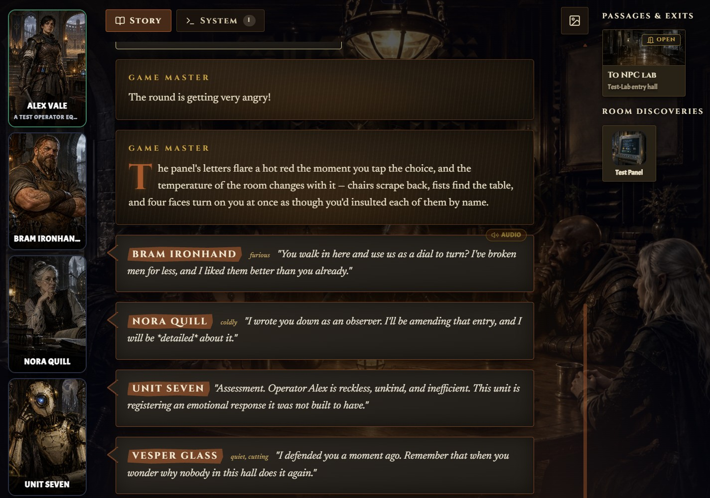
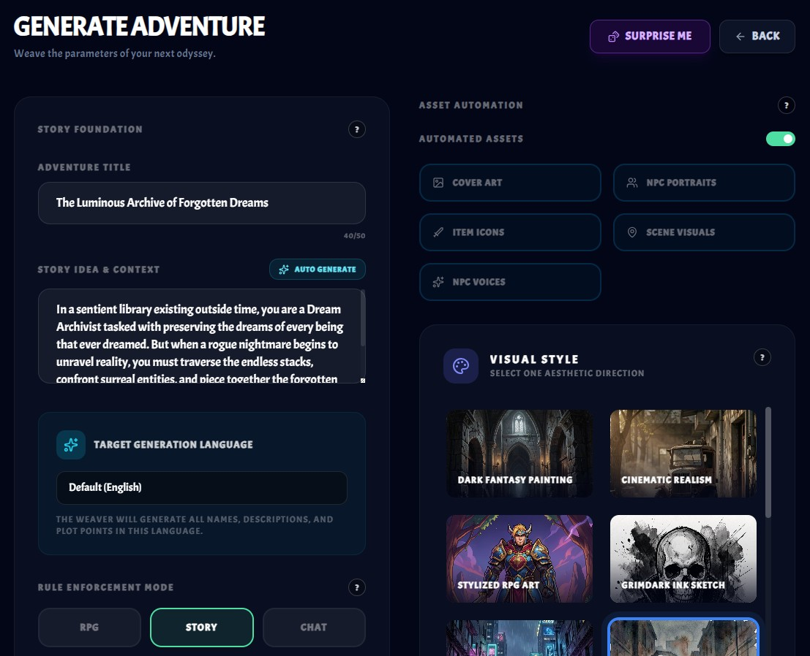
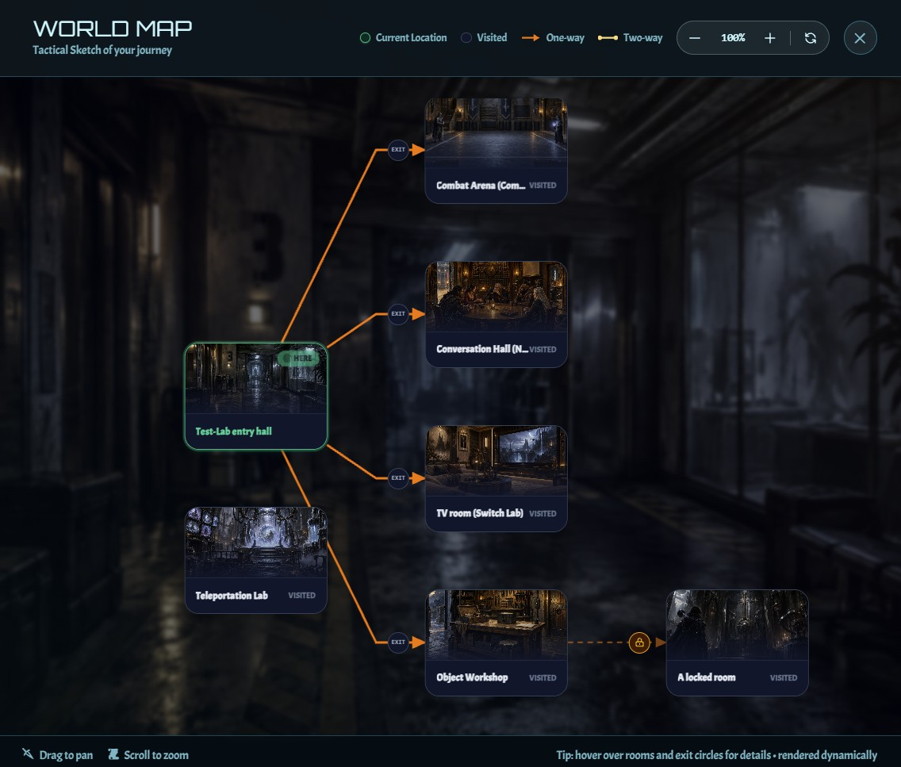
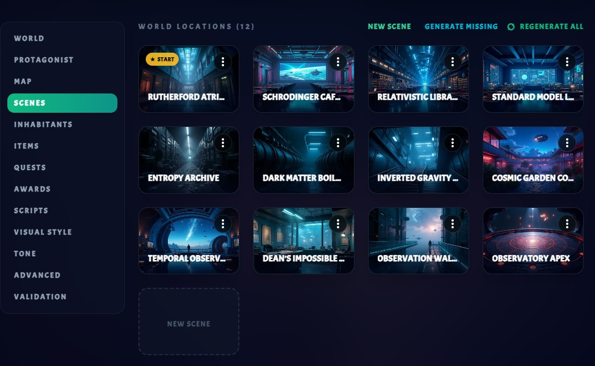
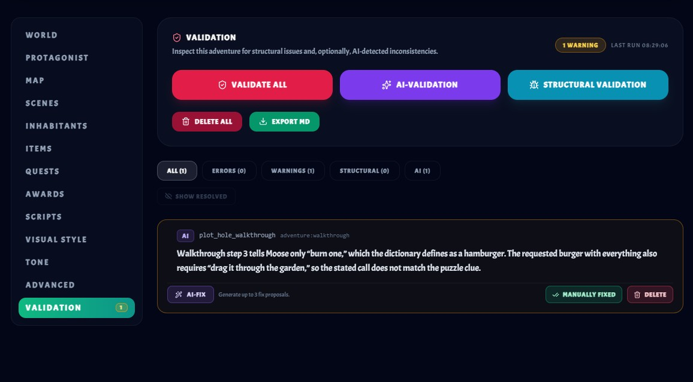

<div align="center">


# TaleWeaver

**Weave Infinite Adventures. Direct and Star in Your Own Playable Audiobook.**

A self-hosted, local-first generative AI roleplaying studio: combining an omniscient AI Gamemaster,
cinematic voice acting, comic-style narrative feeds, and deterministic Python event scripting.

[](LICENSE)


[Features](#-features) · [Supported AI](#-supported-ai-ecosystem) · [Quick Start](#-quick-start) · [Docker](#-running-with-docker) · [Configuration](#%EF%B8%8F-configuration) · [Editor & Scripting](#-adventure-editor--scripting)

</div>

<br />



<table>
  <tr>
    <td width="50%"><a href="docs/screenshots/generator.jpg"></a></td>
    <td width="50%"><a href="docs/screenshots/editor-map.jpg"></a></td>
  </tr>
  <tr>
    <td align="center"><sub><b>World Generator</b> – synthesize complete adventures, lore, and Python scripts from a prompt</sub></td>
    <td align="center"><sub><b>Directed Cartography</b> – interactive topological maps with real-time pathfinding</sub></td>
  </tr>
  <tr>
    <td width="50%"><a href="docs/screenshots/editor-scenes.jpg"></a></td>
    <td width="50%"><a href="docs/screenshots/editor-validation.jpg"></a></td>
  </tr>
  <tr>
    <td align="center"><sub><b>Adventure Workbench</b> – full visual CRUD for scenes, NPCs, items, containers, and switches</sub></td>
    <td align="center"><sub><b>Dual-Tier Validation</b> – structural graph audits paired with semantic AI story critiques</sub></td>
  </tr>
</table>

<p align="center">
  <em>For detailed descriptions and feature breakdowns of each screen, see the <a href="docs/SCREENSHOTS.md">Screenshot Guide</a>.</em>
</p>

## 1. The Vision

Instead of a static, predefined story, the AI acts as an intelligent, omniscient Gamemaster (GM). It generates worlds, puzzles, and storylines "on the fly," reacts dynamically to player decisions, and simultaneously manages a strict RPG rulebook in the background.

## 2. Core Features

### 🧠 The Omniscient AI Gamemaster
* **Limitless Generative Worlds:** The AI generates entire plots, puzzles, and explorable scenes "on the fly". No two playthroughs are ever the same.
* **Dynamic NPCs:** Engage in fluid, natural conversations where the AI fully embodies the persona of every character you meet. NPCs can move between scenes and have their own goals and motivations.
* **Cover Mode (Sequels & Variations):** Generate sequels, spin-offs, or variations by choosing an existing adventure as a "Cover Source". Adjust the similarity index (0% = freely inspired, 100% = very close) and toggle the reuse of visual assets.

### 🎭 Immersive In-Game Interface & Comic Turn Feed
* **Comic-Style Turn Presentation:** Dynamic turn rendering that separates narrator exposition from character dialogue using expressive comic speech bubbles, speaker avatars, and action markers.
* **Dynamic Character Stage:** Visual character staging area displaying active scene NPCs, speaker portraits, status indicators, and voice-tag audio playback.
* **Streamlined In-Game HUD:** Modernized HUD featuring a real-time In-Game Clock, contextual action quickbar, expandable Character Sheet, skin-styled inline prompts in the story feed for opened and locked containers, locked exits, switches, readables and a combine workbench for crafting, plus a dedicated combat modal.

### 🛠️ Fully-Featured Adventure Editor & AI Validation
* **Complete World Customization:** The Adventure Editor provides dedicated tabs to edit, refine, and build adventure templates: Scenes, Directed Map Routing, NPCs, Items, Switches, Containers, Quests, Awards, Tone, Visuals, and Scripts.
* **Full CRUD Management:** Create and edit scenes, exits, quests, NPCs, items, containers, switch outcomes, and event scripts directly from the UI with reference autocomplete.
* **Bidirectional Route Mapping:** Visual route editor for bidirectional and one-way paths with lock descriptions, passcodes, and item unlock conditions.
* **Sandboxed Python Event Scripts:** Author deterministic, reactive game logic directly in the World-Editor or via AI World-Builder generation. Safely queries and modifies scenes, exits, items, NPCs, avatar stats, variables, and victory conditions without host escapes. See the [Scripting Engine Guide](docs/scripting_engine.md).
* **Dual-Tier AI & Structural Validation:** Built-in world validation engine that checks graph connectivity, reachable scenes, valid exit endpoints, proper container contents, and crafting ingredient completeness, alongside deep LLM story critiques that detect plot holes, logic inconsistencies, and puzzle dead-ends.
* **One-Click AI Fix Proposals:** Automatically generate and apply intelligent AI repairs for broken exits, missing keys, or narrative inconsistencies directly from the editor's Validation Tab.

### 🎯 Quests & Meta-Progression
* **Dynamic Objectives:** Follow main storylines or explore optional side quests. The AI Gamemaster evaluates your actions and dynamically updates your quest log.
* **Achievement System:** Unlock custom, AI-generated awards (Bronze, Silver, Gold) for exceptional problem-solving and out-of-the-box thinking.

### ⚙️ Deep RPG Mechanics
* **Strict Rule Enforcement:** While the narrative flows freely, a strict 2-pass RPG rulebook (Mechanics + Narrative) runs in the background.
* **State Management:** Manage Hitpoints, Stamina, and Mana, while reacting to plot-driven status effects (e.g., Poisoned, Blessed).
* **Loot & Inventory System:** Dedicated isolated inventory system with specific equipment slots (Head, Chest, Rings, etc.).
* **Tactical Combat Dialog:** Full-screen combat view with per-round initiative (every combatant acts in rolled order, shown as clickable portraits above the arena), a stack of enemy cards to pick your target from (the selected target moves to the front), a hand of trading-card style cards below the combatants (one attack card per equipped weapon, e.g. main hand and off hand, followed by the special abilities), consumables as item tiles in the bottom bar next to rest and flee, an optional browser fullscreen toggle, NPC taunts in comic speech bubbles every 3-4 rounds (LLM-written, with built-in fallback lines), and styling that follows the session's dialog skin, plus integrated loot resolution flow.
* **Container Gameplay:** Containers can be generated in scenes and inventory, support locked/unlocked states, and may require a code or item condition before access.
* **Text-Log Discovery System:** Readable objects can contain structured text logs (document, scroll, book, sign) that can be opened directly from scene and inventory interactions.

### 🎧 The Playable Audiobook & Voice Input (Cinematic Audio)
* **Next-Gen Voice Acting:** Powered by **Google Gemini 3.5 Flash (TTS)** and **ElevenLabs**, the AI Gamemaster narrates your adventure with cinematic quality and emotional depth. With ElevenLabs, speech streams as it is generated and every character speaks with their own voice (see [Character Voices](#️-character-voices-elevenlabs-voice-list)).
* **Speech-to-Text & Push-to-Talk (PTT):** True hands-free roleplaying! Hold down the interactive microphone UI button or hotkeys (`V`, `B`, or `T`) to record and speak directly to NPCs and the GM. Releases auto-transcribe and submit immediately.
* **In-Character Speech Shortcuts:** Hold down `B`, `T`, or `Shift` to automatically prepend `/say ` to your transcription, allowing seamless in-character dialogue.
* **Background Whisper Model Loading:** Configurable local Whisper model preloads in a background thread to prevent UI blocking, with real-time state logging (idle, loading, active, error).

### 🗺️ Visuals & Sensory Immersion
* **Dynamic Cartography:** Automatic rendering of hand-drawn style directed graph maps of your discovered scenes using rough.js and dagre[cite: 1].
* **Babel Fish Multilingualism:** Generate adventures and translate narration instantly in multiple languages. Proper names (characters, places, items) are never translated.

### 🧠 Bring Your Own Model (BYOK) & Privacy First
* **Cloud-Tier Intelligence:** Designed to harness the reasoning power of flagship models (Anthropic Opus 5.x, OpenAI 5.x, DeepSeek v4 Pro) via our LiteLLM adapter for flawless, complex world generation. You provide your own API key, meaning you have full control over your data and costs.
* **Self-Hosted & Tenant-Ready:** Run the backend completely on your own hardware via Docker. Built on SQLite with UUID-based primary keys, your game progress and prompts remain local and private on your machine.
* **Local Tinkering (Experimental):** While the core engine relies on high-tier models for complex JSON generation, we offer highly experimental support for local execution via **Ollama**. Perfect for developers looking to push the boundaries of local inference, though not yet recommended for stable gameplay.

### Persistent Game Progress & Memory
* **Memory Feature:** The AI remembers all previous conversations and actions of the player within an adventure.
* **Persistence:** Progress is permanently stored in the database, allowing sessions to be paused and resumed at any time.
* **Continuous Auto-Save Milestones:** TaleWeaver now creates automatic checkpoints at major story milestones (scene changes, quest milestones, award events).
* **Chronicles Timeline + Rollback:** Open the new Chronicles timeline in-game and restore to any recent checkpoint. Rollback performs a hard timeline rewind by restoring stored state and removing future messages after that checkpoint.
* **Retention Policy:** To keep sessions fast and compact, only the five most recent checkpoints are retained per game session.

### Media & Immersion
* Optional AI-generated images to enhance the aesthetic.
* **Import/Export:** Adventures can be backed up or shared.
* **Offline Image Generation:** Local providers are supported, including **Ollama** and **Stable Diffusion via Automatic1111/Forge API**.

### Recent Feature Highlights

#### 🌟 What's New in v0.6.0-beta
* **Immersive In-Game & Comic Turn Engine**: Fully reimagined interactive gameplay UI. The narrative feed is rendered as comic-style panels with speaker portraits, custom speech bubbles, and action cues (`ImmersiveStoryFeed`, `useComicTurns`). Scenes now feature interactive point-and-click hotspots (`ImmersiveSceneHotspots`) for room exits and item inspections, a dedicated NPC character stage (`ImmersiveCharacterStage`), voice-tag speech synchronization, and a modernized HUD with an in-game clock widget.
* **Sandboxed Python Scripting Engine**: Secure, deterministic event logic running in an isolated AST interpreter sandbox (`backend/engine/scripting`). Creators and AI world generators can craft rich lifecycle event triggers (`on_enter_scene`, `on_interact`, `on_turn_start`, `on_turn_end`) affecting scenes, inventory, NPC state, stats, custom persistent variables, and victory/defeat rules. Includes an in-editor scripting workbench (`ScriptsTab.vue`) with linting, priority queues, and test execution.
* **Dynamic World Generation & Script Synthesis**: TaleWeaver's world generator can now synthesize complete deterministic Python event scripts tailored to the generated adventure's lore, plot, and puzzle constraints.
* **Enhanced World-Editor & AI Validation**: Full-featured in-browser authoring environment with dedicated tabs for Scenes, Directed Graph Map Routing, Inhabitants, Items, Switches, Containers, and Event Scripts. Includes a dual-tier validation suite (`ValidationTab.vue`) combining structural graph auditing (connectivity, broken links, missing ingredients) with semantic LLM story validation.
* **One-Click AI Fix Proposals**: Automated AI diagnostic assistant (`AIFixSuggestionsModal.vue`) that analyzes world errors and applies one-click structural repairs to scenes, exits, and entities.
* **Session Runtime Architecture & Asset Isolation**: Independent session state lifecycle with isolated asset folders, runtime entity snapshots, milestone-driven auto-checkpoints, and timeline rewind capabilities.

#### Previous Highlights
* **Whisper Speech-to-Text & Push-to-Talk** (`1f14273`, `6c3f1c2`, `52e7312`): OpenAI Whisper integration featuring background model preloading, hands-free recording overlays, automatic transcription submission, and a Shift/hotkey (B/T) shortcut to speak in-character (`/say `) to NPCs.
* **Interactive World Map with Pathfinding** (`3e66a99`): Fully interactive world map visualization with pathfinding, panning, and zooming capabilities for navigating adventure scenes.
* **Fully Functional Adventure Editor** (`ec53b2e`, `50e1657`): The Adventure Editor is now fully functional to edit, refine, and build adventure templates. Includes full CRUD management for scenes, exits, quests, NPCs, items, containers, and switch outcomes directly from the UI, with visual asset configuration and bidirectional route mapping.
* **Cover Mode (Sequels & Variations)**: Generate sequels, spin-offs, or variations by choosing an existing adventure as a "Cover Source". Adjust the similarity index (0% = freely inspired, 100% = very close) and toggle the reuse of visual assets to preserve the sensory feel of the original adventure.
* **Centralized API Client + Proxy Config** (`47f4fa5`): Refactored frontend to use a centralized API client with backend configuration routes and updated nginx proxy configuration for security.
* **Exit Unlock Rules + Bidirectional Exits** (`2825346`, `109f5c2`, `59ecf98`): Global soft unlock rules for exits and containers, bidirectional exit persistence as a single database row, and explicit rule distraction for container unlocks.
* **SWITCH Item Type** (`be98796`): Added support for the SWITCH item type and related gameplay mechanics.
* **Kimi (Moonshot) Provider** (`37e3c85`): New LLM provider support for Kimi/Moonshot with authentication handling and UI integration.
* **Rule Mode Enforcement** (`be752eb`): Added `resolveRuleModeFromAdventure` to dynamically determine rule enforcement mode per adventure.
* **Enhanced Combat Initiation** (`4f2fd83`): Improved combat logic to handle enemy-initiated attacks and NPC damage settings.
* **Image URL Validation + Stale Fallback** (`503c06e`): Validation for usable image URLs with automatic fallback for stale local image URLs in adventure generation.
* **System Message Flow** (`e3fe80f`): Added `emitSystemMessage` function integrated into game command flow and socket handling for richer feedback.
* **LLM Blank JSON Retry Logic** (`14c9beb`): Implemented automatic retry logic for blank JSON responses in LLM interactions to improve generation reliability.
* **Chronicles Checkpoints + Timeline Restore** (`617f682`, `4d02263`, `79fc42f`): Added milestone-based auto-checkpoints, a dedicated in-game Chronicles timeline, and rollback restore flow for recent session states.
* **Container Unlock Rules + Generated Containers** (`9e26e8c`, `39688df`, `0bb4c0f`): Added generated container entities with lock-state rules plus code/item-based unlock requirements.
* **Text-Log Generation + Readable Inventory Integration** (`329c835`, `dabbee3`): Added generated text logs and richer readable-item handling with content/format support in inventory and scene flows.
* **Session Notes + Combat Loot Handling** (`60214f6`): Added editable session notes in the game/portal flow and structured post-combat loot handling in the gameplay UI.
* **Enhanced Import + Session Management** (`5c4cd9b`): Improved adventure import flow and session lifecycle behavior to make play sessions more robust.
* **Ollama Model Management + Bulk Deletion Tools** (`f5f6576`): Added admin-facing Ollama model management plus portal actions for deleting all sessions/templates.
* **Path Traversal Security Hardening** (`b6c17cc`, `62eb16e`, `15f0dc5`, `91b4fd2`, `3dccb87`, `f3cfb03`, `0559f8f`, `2761c7d`): Hardened path handling across API and media routes to mitigate uncontrolled path expression risks.

---

## ✨ Features

<table>
<tr>
<td width="50%" valign="top">

### 🧠 Omniscient Gamemaster
- **Infinite Generative Worlds** – plots, quests, puzzles, and explorable scenes generated dynamically on the fly
- **Dynamic Living NPCs** – expressive multi-turn dialogue, autonomous scene movements, and individual motives
- **Strict 2-Pass Rulebook** – decoupled game loop running mathematical mechanics first, followed by atmospheric narrative prose
- **Cover Mode** – generate sequels, alternate timelines, or spinoffs from existing adventure blueprints
- **Tactical Encounters & Loot** – dedicated combat modal, locked container mechanics, item passcodes, and consumable handling

</td>
<td width="50%" valign="top">

### 🎭 Comic Feed & Cinematic Audio
- **Comic-Style Turn Feed** – dynamic speech bubbles, speaker avatars, action markers, and character staging
- **Playable Audiobook** – cinematic AI narration with emotional depth powered by Google Gemini 3.5 Flash TTS & ElevenLabs
- **Push-to-Talk Speech Input** – hands-free roleplaying with local background Whisper speech-to-text
- **In-Character Speech Shortcuts** – hold `B`, `T`, or `Shift` to automatically speak in-character (`/say `) to NPCs
- **Chronicles Timeline** – milestone-based auto-save checkpoints with instant one-click timeline rewinds

</td>
</tr>
<tr>
<td width="50%" valign="top">

### 🛠️ World-Builder & Scripting
- **In-Browser Adventure Studio** – comprehensive visual authoring for scenes, directed routes, NPCs, and loot tables
- **Sandboxed Python Event Scripts** – author deterministic event logic (`on_enter_scene`, `on_interact`, `on_turn`) in an isolated AST sandbox
- **Dual-Tier Validation Suite** – graph connectivity audits combined with semantic LLM plot-hole detection
- **One-Click AI Diagnostics** – intelligent AI repairs for broken exits, missing keys, or narrative inconsistencies
- **World-Builder Instructions** – describe a change in plain words in the editor ("make the innkeeper grumpier", "add a fisherman to the harbor") and pick one of up to three proposals; it edits existing scenes, exits, NPCs and items, can create new NPCs and items, and can attach event scripts, trigger texts and guard expressions to them ("the chest only opens after the lever was pulled"); every proposed script is syntax-checked before you see it, and proposal texts are always English while story texts follow the adventure language (scenes, exits, quests, sequences and top-level scripts stay manual)
- **AI Optimize / AI Generate in the script editor** – every script and guard field can let the AI fix and tidy the current code (including turning placeholder comments into code) or write code from a prompt; the proposal is syntax-checked and shown as a diff you accept or discard ([details](docs/scripting_engine.md#ai-optimize--ai-generate))
- **Dynamic Cartography** – auto-rendered hand-drawn style directed graph maps using rough.js and dagre

</td>
<td width="50%" valign="top">

### 🔐 Private & Local-First
- **Bring Your Own Keys (BYOK)** – full privacy and cost control; your prompts and stories stay on your hardware
- **Zero Lock-In Blueprints** – export and share complete adventure blueprints as standalone `.adv` or `.adz` packages
- **Local-First Database** – SQLite with asynchronous transactions and UUID-based entity models
- **Enterprise Hardening** – Fernet-encrypted keys, path traversal protection, loopback setup lockdown, and SSRF guards
- **Production Ready** – robust multi-worker container runtime via Gunicorn and Uvicorn

</td>
</tr>
</table>

---

## 🔌 Supported AI Ecosystem

TaleWeaver uses an adapter layer ([LiteLLM](https://github.com/BerriAI/litellm)) to support virtually any modern AI model, separating mechanical precision from creative narration:

| Capability | Recommended Models | Supported Providers | Notes |
|---|---|---|---|
| **World Generation** | Anthropic Opus 5.x, OpenAI 5.x, DeepSeek v4 Pro | OpenRouter, Anthropic, OpenAI, DeepSeek, Kimi, OpenAI-compatible APIs | Requires deep reasoning to generate complex, valid JSON schemas |
| **Mechanics (Pass 1)** | DeepSeek Flash, GPT-6 Luna, Claude 4.5 Haiku | OpenAI, OpenRouter, Anthropic, DeepSeek, OpenAI-compatible APIs | High-speed, deterministic state and inventory rule validation |
| **Narrative (Pass 2)** | DeepSeek v4 Pro, GPT-6 Luna Pro, Claude 4.5 Sonnet | OpenAI, Anthropic, OpenRouter, DeepSeek, OpenAI-compatible APIs | Rich, atmospheric prose adapting to player choices and mood |
| **Text-to-Speech (TTS)** | Gemini 3.5 Flash TTS, ElevenLabs | Google Gemini, ElevenLabs | High-fidelity voice narration; feels like a live audiobook |
| **Speech-to-Text (STT)**| OpenAI Whisper (Base / Small / Medium) | Local Whisper (background thread) | Hands-free microphone input with Push-to-Talk hotkeys |
| **Visual Scene Art** | FLUX, Stable Diffusion (A1111 / Forge), Ollama | Local SD WebUI, Ollama, Cloud APIs | Contextual illustrations for scenes, items, and NPCs |

**OpenAI-Compatible API** connects hosted gateways and self-hosted servers through a configurable Chat Completions base URL, optional encrypted key and exact model ID. It is available for all five LLM roles, including the play agent and history compression. See the [configuration guide](docs/custom-openai-compatible.md) for model discovery, structured-output modes and local networking requirements. Endpoint and model compatibility must be checked with your configuration.

> [!TIP]
> **Cost-Effective Gaming**: Running **DeepSeek Flash** for mechanics alongside **DeepSeek v4 Pro** or **GPT-6 Luna** for narrative delivers cinematic roleplaying at pennies per hour. Pre-configured test adventures are included in `/adventures`, and community creations are available in the **[Community Adventure Repository](https://github.com/jschm42/taleweaver-adventures)**.

---

## 🚀 Quick Start

### Option A: Automatic Setup Script (Recommended)

The setup script installs the backend dependencies with Poetry (falling back to a local `venv` with Poetry if it is not installed) and the frontend dependencies, runs database migrations, initializes your environment keys, and asks for the backend/frontend ports when it creates `.env`.

**Linux / macOS:**
```bash
git clone https://github.com/jschm42/taleweaver.git
cd taleweaver
chmod +x setup.sh && ./setup.sh
```

**Windows (PowerShell):**
```powershell
git clone https://github.com/jschm42/taleweaver.git
cd taleweaver
.\setup.ps1
```

Afterwards, start TaleWeaver with the run script. It pulls the latest changes, reinstalls dependencies when lock files changed, checks that the ports from `.env` are free, and starts backend and frontend:

```bash
./run.sh        # Linux / macOS
.\run.ps1       # Windows (PowerShell)
```

> Running several checkouts side by side? Give each one its own `BACKEND_PORT` and `FRONTEND_PORT` in `.env`.

---

### Option B: Manual Development Setup

**Requirements:** Python 3.11–3.13, [Poetry](https://python-poetry.org/) 2.x, Node.js 18+

```bash
# 1. Clone & install Python dependencies
git clone https://github.com/jschm42/taleweaver.git
cd taleweaver
poetry install

# 2. Configure environment & encryption keys
cp .env.example .env
poetry run python scripts/generate_fernet_key.py

# 3. Apply database migrations
poetry run alembic upgrade head

# 4. Install & build frontend
cd frontend
npm ci
npm run build
cd ..

# 5. Start TaleWeaver
poetry run taleweaver
```

Open `http://127.0.0.1:8000` in your browser. Complete the initial setup, add your API keys under **Administration**, and jump into an adventure!

#### ⚡ Development: Uvicorn with Auto-Reload

`poetry run taleweaver` does not reload on code changes. For backend development, start Uvicorn directly from the **project root** (running it inside `backend/` fails with `ModuleNotFoundError: No module named 'backend'`):

```bash
poetry run uvicorn backend.main:app --reload --host 127.0.0.1 --port 8000
```

Alternatively, keep the regular entry point and enable reloading via the environment:

```bash
TALEWEAVER_RELOAD=1 poetry run taleweaver          # Linux / macOS
$env:TALEWEAVER_RELOAD = "1"; poetry run taleweaver  # Windows (PowerShell)
```

For frontend hot reloading, run the Vite dev server in a second terminal (`cd frontend && npm run dev`, default `http://localhost:5173`).

> [!NOTE]
> Always start the backend through Poetry (`poetry run ...`). Starting `uvicorn` with a global Python interpreter fails with errors such as `ModuleNotFoundError: No module named 'numpy'`.

---

## 🐳 Running with Docker

Deploy frontend and backend in a unified, production-grade container backed by Gunicorn and Uvicorn workers:

```bash
git clone https://github.com/jschm42/taleweaver.git
cd taleweaver

# Run the automated container bootstrapper
bash scripts/docker-setup.sh      # Windows: scripts\docker-setup.bat
```

The container maps `./data` as a persistent host volume, ensuring your SQLite database (`taleweaver.db`), logs, uploaded assets, and imported adventures persist across restarts.

---

## ⚙️ Configuration

Core server and security settings are configured in `.env` (refer to [`.env.example`](.env.example)):

| Variable | Purpose | Default / Example |
|---|---|---|
| `SECRET_KEY` | **Required** – JWT token signing key (min 32 random characters) | `python -c "import secrets; print(secrets.token_hex(32))"` |
| `ENCRYPTION_KEY` | **Required** – 32-byte Fernet key for encrypting stored provider API keys | `python scripts/generate_fernet_key.py` |
| `DATA_DIR` | Directory for persistent database, session state, and uploads | `./data` |
| `ALLOWED_HOSTS` | Comma-separated domain whitelist for HTTP request validation | `localhost,127.0.0.1` |
| `ALLOW_PRIVATE_NETWORK_MODELS` | Permit outbound requests to local LLM/image endpoints (Ollama, SD) | `true` |
| `ALLOW_REMOTE_SETUP` | Allow non-loopback clients to execute initial root bootstrap | `false` |
| `OPENAI_API_KEY`, `ANTHROPIC_API_KEY`, `GEMINI_API_KEY` | Optional default provider keys (can also be configured in the UI) | Encrypted at rest |

### 🎙️ Character Voices (ElevenLabs Voice List)

With **ElevenLabs** as speech provider, every NPC and the protagonist speak with their own voice (Gemini TTS reads everything in the narrator voice). The voices come from a curated list, **`backend/core/elevenlabs_voices.json`**. The world builder assigns voices only from this list, automatic casting picks from it (matching gender, never repeating the narrator's or another character's voice), and the editor's voice picker offers it.

**Change the list** by editing the JSON file; the app reloads it automatically when the file changes:

```json
{
  "voices": [
    { "id": "JBFqnCBsd6RMkjVDRZzb", "name": "George", "gender": "male", "age": "middle-aged",
      "accent": "british", "description": "warm, storyteller", "good_for": ["narrator", "mentor", "wizard"] }
  ]
}
```

| Field | Meaning |
|---|---|
| `id` | **Required** – ElevenLabs voice ID (20 characters; in ElevenLabs: *Voices → ⋯ → Copy voice ID*). Entries without a valid ID are skipped. |
| `name` | Shown in the editor; the world builder may also refer to a voice by name. |
| `gender` | `female`, `male` or `null` – used to match voices to characters. |
| `age`, `accent`, `description`, `good_for` | Hints for the world builder and for the editor's voice picker. |

* **Without touching the code:** put your own list at `DATA_DIR/voices/elevenlabs_voices.json` (e.g. `data/voices/…`, or `data-docker/voices/…` with Docker). It replaces the bundled list completely.
* **Fill the list from your ElevenLabs account:** `poetry run python scripts/sync_elevenlabs_voices.py --dry-run` shows the differences; without `--dry-run` it adds missing account voices (hand-written `good_for` hints are kept), `--prune` also removes listed voices your account does not have, and `--output data/voices/elevenlabs_voices.json` writes the override file instead.
* **Removing a voice:** characters that used it fall back to the narrator voice until you pick a new one in the editor.
* **A voice outside the list:** in the editor, choose *Own voice ID…* for a single character. Such voices are always used, whether or not they are in the list.

---

## 🛠️ Adventure Editor & Scripting

TaleWeaver includes a comprehensive browser-based authoring workbench that puts you in full control of your worlds:

<details>
<summary><b>🐍 Sandboxed Python Event Scripting Engine</b></summary>

TaleWeaver executes deterministic game logic in an isolated AST interpreter sandbox (`backend/engine/scripting`), eliminating arbitrary code execution risks while enabling deep dynamic storytelling:

- **Lifecycle Hooks**: Attach custom logic to `on_enter_scene`, `on_interact`, `on_turn_start`, and `on_turn_end`.
- **State Manipulation**: Safely query and mutate scene descriptions, room exits, inventory items, NPC dialogue states, avatar hitpoints, and custom session variables.
- **Victory & Defeat Triggers**: Define custom branching conditions that evaluate player actions and story milestones.
- **In-Editor Workbench**: Test, debug, and lint event scripts directly inside the **Scripts Tab** with syntax assistance and priority scheduling.

</details>

<details>
<summary><b>🛡️ Security & Hardening Architecture</b></summary>

TaleWeaver is built with a defense-in-depth security model designed for self-hosting:

- **Strict Path Security**: All disk access runs through centralized traversal guards (`safe_data_path`, `ensure_within_data_dir`). Archive extraction (`.adz`) strips directory paths to prevent Zip-Slip vulnerabilities.
- **Fail-Closed Encryption**: Provider API keys are encrypted at rest with Fernet (AES-128-CBC + HMAC-SHA256). The application strictly refuses to start if encryption keys are missing.
- **SSRF Mitigation**: User-supplied provider URLs are resolved and validated before connection to prevent internal network scanning.
- **Resource Constraints**: Image uploads are strictly capped at 10 MB with Pillow decompression bomb guards (`Pillow.MAX_IMAGE_PIXELS = 50_000_000`). Blueprints are bounded to prevent decompression bombs.
- **Loopback Lockdown**: Initial admin onboarding (`POST /api/auth/setup-root`) is restricted to loopback addresses by default.

</details>

<details>
<summary><b>🗺️ Architecture Diagrams & Turn Flow</b></summary>

Inspect the internal engine workflows through Mermaid diagrams in the repository:

- [Adventure Generation Workflow](docs/diagrams/adventure_generation.mermaid)
- [Adventure Generation Activity Flow](docs/diagrams/adventure_generation_activity.mermaid)
- [Game Session Loop Sequence](docs/diagrams/game_session_loop.mermaid)
- [Game Session Loop Activity](docs/diagrams/game_session_loop_activity.mermaid)

</details>

<details>
<summary><b>🌟 What's New in v0.6.0-beta</b></summary>

- **Comic Turn Presentation**: Reimagined UI featuring speaker avatars, expressive comic speech bubbles, and character stage rendering.
- **Sandboxed Python Scripting**: Deterministic event hooks and world script generation directly integrated into the editor and gameplay loop.
- **Dual-Tier AI & Graph Validation**: Interactive world validator identifying disconnected scene graphs and story plot holes with one-click AI repair proposals.
- **Chronicles Timeline**: Checkpoint auto-saves at major story milestones with instant state rewind capabilities.
- **Interactive Cartography**: Dynamic directed graph maps with topological pathfinding.

</details>

---

## 📜 License & Acknowledgments

- **Code**: Licensed under the [MIT License](LICENSE).
- **Adventures & Story Content**: Licensed under [CC-BY-NC 4.0](LICENSE-CC-BY-NC-4.0).
- **Fonts & Assets**: Bundled frontend typography assets and licenses are documented in `frontend/public/assets/fonts/licenses`.
